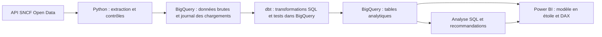
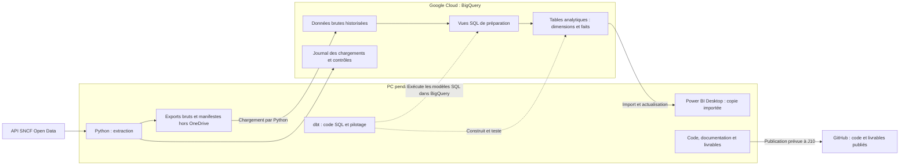

# SNCF Service Reliability Analytics — Plan de réalisation

Date du plan : 9 septembre 2026.

Dernière révision : 9 octobre 2026 — publication de l’état validé J01–J04. Révision pédagogique et du stockage discutée le 28 septembre 2026 et intégrée le 1er octobre 2026 après validation du porteur du projet.

Ce document sert de référence aux prochaines conversations adossées au dépôt. **Une conversation = un jalon.** Il décrit le travail à réaliser ; sa présence ne signifie pas que les jalons sont implémentés ou validés.

**Choix confirmé par le porteur du projet : BigQuery.** PostgreSQL ne fait pas partie de la V1. Les règles métier encore incertaines doivent être résolues ou encadrées au jalon 1, sans inventer les définitions manquantes.

**Fonctionnement pédagogique confirmé : expliquer chaque jalon en détail, puis attendre le retour et l'accord du porteur du projet avant son implémentation.** Cette règle s'applique à chaque nouvelle conversation de jalon, même lorsque la demande initiale emploie le mot « implémenter ». Voir la section 4.2. La validation du présent plan ne vaut pas accord anticipé pour implémenter les jalons.

**Publication progressive autorisée le 9 octobre 2026.** Le porteur demande un premier commit de l'état validé J01–J04 et son envoi sur le dépôt GitHub du projet, puis un commit et un envoi à la clôture de chaque prochain jalon validé. Cette instruction complète le calendrier initial : J10 reste la livraison finale, tandis que l'historique du code est publié dès maintenant. L'accord préalable d'implémentation de chaque jalon reste obligatoire. Avant chaque envoi : fichiers indexés contrôlés, preuves publiques anonymisées, aucune donnée source complète ni identité privée, puis vérification du commit distant.

## 1. Objectif métier et finalité du portfolio

Question métier :

> Comment identifier les lignes et les causes responsables de la dégradation de la qualité de service afin de prioriser les actions opérationnelles ?

Le projet doit produire un outil de diagnostic mensuel destiné à une équipe fictive de pilotage de la qualité de service. Il doit permettre de :

1. Identifier les liaisons dont la qualité se dégrade sur des périodes comparables.

2. Distinguer cette dégradation d'une sous-performance durable et d'un simple effet de volume.

3. Examiner les motifs de retard déclarés et la qualité des informations disponibles.

4. Proposer des investigations opérationnelles justifiées, avec des indicateurs de suivi.

La dégradation est une hypothèse à tester, pas un résultat imposé. Des améliorations ou une absence de dégradation constituent aussi des résultats valides. Les observations mensuelles permettent une analyse descriptive ; elles ne suffisent pas, à elles seules, à démontrer une causalité ni l'efficacité d'une action.

Finalité : publier un projet accessible aux recruteurs et défendable en entretien Data Analyst, démontrant **API, Python, ELT, BigQuery, SQL, dbt, qualité des données, modélisation en étoile, Power Query, DAX, KPI et storytelling**.

## 2. Périmètre et décisions d'architecture

### 2.1 Première version

- Source principale : régularité mensuelle TGV par liaison, identifiant `regularite-mensuelle-tgv-aqst`.

- Ingestion de tout l'historique disponible ; liaisons nationales comme vue métier principale. Conserver le champ national/international et rendre le filtre explicite.

- Granularité attendue : mois × gare de départ × gare d'arrivée × service, à vérifier par les données.

- Liaisons orientées : A → B et B → A restent distinctes.

- Lecture métier centrée sur les dernières années disponibles, avec périodes exactes et règles de complétude arrêtées au jalon 1.

- Documentation métier et rapport en français ; noms techniques en anglais, cohérents dans tout le dépôt.

- Power BI Desktop en mode Import. Captures, synthèse et PDF accessibles depuis GitHub ; accès interactif public facultatif.

- Intercités en extension après une première version TGV publiable.

Ne pas ajouter à la V1 de météo, fréquentation voyageurs, prédiction, NLP des commentaires ou orchestration lourde sans besoin métier établi. La richesse du projet doit venir de la rigueur de l'analyse et de sa reproductibilité.

### 2.2 Architecture retenue



- Python extrait, contrôle le transport et charge les données. Les règles analytiques sont implémentées dans SQL/dbt.

- dbt Core avec l'adaptateur BigQuery ; versions compatibles de Python et des dépendances verrouillées au jalon 2.

- Projet Google Cloud dédié, localisation cohérente, permissions adaptées aux besoins et consommation contrôlée.

- BigQuery avec facturation activée pour la cible durable. Ne pas fonder la livraison sur les restrictions et l'expiration du Sandbox.

- Définir un budget, des alertes, des quotas et des limites de requêtes adaptés. Une alerte budgétaire n'est pas un plafond bloquant. Aucune gratuité n'est garantie.

- Organiser les données brutes, analytiques et d'audit ; isoler les environnements de développement et de test des données utilisées par le rapport publié.

- Privilégier une extraction complète contrôlée au volume actuel. Elle doit détecter les corrections historiques, y compris les changements d'effectifs et les suppressions de lignes source. L'incrémental n'est pas une exigence artificielle du portfolio.

- Conserver un historique de chargements et une version figée des données permettant de reproduire une publication.

- Définir l'actualisation après observation du rythme de publication SNCF. Le grain mensuel ne garantit pas une publication chaque mois.

### 2.3 Où les données seront stockées et où les traitements s'exécuteront

**Des copies de travail seront présentes sur le PC ; BigQuery restera l'entrepôt de référence dans le cloud Google.** Le lieu depuis lequel un programme est lancé ne détermine pas le lieu de stockage ou d'exécution des calculs. Par exemple, dbt sera lancé depuis le PC mais enverra les transformations SQL à BigQuery, qui les exécutera dans le cloud.

Cette section décrit l'architecture cible. Les emplacements et ressources seront créés aux jalons correspondants, après leur présentation pédagogique et l'accord du porteur du projet.



#### Calendrier du stockage

| Jalon | Sur le PC | Dans BigQuery | Utilité |

|---|---|---|---|

| J01 — Audit | Export source utilisé, métadonnées et résultats d'exploration | Aucun chargement nécessaire pour cet audit initial | Examiner une version identifiable de la source |

| J02 — Environnement | Code, configuration, éventuelle petite copie Power BI de test | Petite table d'essai | Vérifier les connexions de bout en bout |

| J03 — Ingestion | Export brut et manifeste de chaque version extraite | Données brutes historisées et journal des chargements | Charger une source traçable et rejouable |

| J04–J05 — Transformation | Fichiers SQL/dbt, documentation et journaux | Vues de préparation et tables analytiques | Nettoyer, tester et structurer les données |

| J06 — Analyse | Requêtes, résultats sélectionnés et synthèses | Données interrogées et calculs SQL | Produire les constats métier |

| J07 — Power BI | Copie importée des tables utiles, définitions du modèle et rapport | Tables analytiques de référence | Explorer et afficher les résultats |

| J08–J10 — Livraison | Captures, PDF et fichiers de livraison | Version des données utilisée par le rapport publié | Présenter les résultats et permettre leur reproduction |

#### Fichiers locaux d'extraction

Un **export brut** est une copie de la source avant les transformations métier. Il permet de vérifier ce qui a été reçu et de rejouer un traitement lorsque la source évolue. Un **manifeste** est un petit fichier de description associé : source, date d'extraction, nombre d'observations, identifiant de version et empreinte de contrôle. Une **empreinte** est une valeur calculée à partir du contenu pour détecter s'il a changé.

Le dossier par défaut sera `%LOCALAPPDATA%\SNCF_Service_Reliability_Analytics\data`, soit sur le PC actuel `C:\Users\<utilisateur>\AppData\Local\SNCF_Service_Reliability_Analytics\data`. Il sera configurable par la variable d'environnement `SNCF_DATA_DIR`, documentée à J02 et utilisée dès J01 pour les exports d'audit.

Ce dossier se situe hors du dépôt, actuellement dans OneDrive : les exports de travail ne doivent pas encombrer l'historique Git ni dépendre de la synchronisation du dossier de code. Ils seront conservés pendant le développement, sans purge automatique. Les traces nécessaires à la reprise d'un échec seront préservées. Une copie locale seule ne constitue pas une sauvegarde indépendante du PC.

#### Données dans BigQuery

Un **entrepôt de données** est un espace central organisé pour les analyses. Un **dataset BigQuery** est un conteneur logique de tables et de vues ; il ne correspond pas à un dossier sur le disque du PC.

- **Zone brute :** observations reçues, avant nettoyage métier, rattachées à leur version de chargement. Les différentes versions conservées ne doivent pas être additionnées comme des observations métier supplémentaires.

- **Zone analytique :** préparations SQL, dimensions et faits utilisés pour l'analyse et le rapport.

- **Zone d'audit :** tentatives de chargement, dates, effectifs, statuts et résultats des contrôles.

Pour la V1, les modèles de préparation staging/intermediate seront des **vues SQL classiques** : une vue enregistre une requête et ne stocke pas une copie persistante de son résultat. Les dimensions, faits et marts seront **matérialisés en tables**, c'est-à-dire que leurs résultats seront stockés. Cette séparation conserve une préparation lisible et des tables finales prêtes pour Power BI. Une évolution de ce choix devra être justifiée par un besoin mesuré et documentée.

Les fichiers locaux seront chargés directement dans BigQuery par Python. **Google Cloud Storage n'est pas requis dans la V1.** Ce service de stockage de fichiers pourra être présenté comme une extension pour un archivage indépendant, avec ses bénéfices et sa gestion supplémentaire.

Les données BigQuery persistent lorsque le PC est éteint, selon les règles de conservation configurées. Une extraction lancée localement dépend en revanche du fonctionnement du PC. Les versions brutes historisées permettent de reconstruire les données analytiques ; les archives de publication conservent aussi l'export de référence et son manifeste.

#### Copie de travail Power BI et publication

Le mode **Import** copie dans Power BI les tables et colonnes sélectionnées. Les interactions avec le rapport utilisent cette copie ; une actualisation est nécessaire pour intégrer les changements de BigQuery. L'import des données ne signifie pas que chaque clic du rapport interroge BigQuery.

Avec PBIP, les définitions du modèle et du rapport sont séparées du **cache local**, qui contient les données de travail et doit être exclu de Git. Un fichier PBIX de livraison en mode Import peut contenir les données importées. Il faut distinguer les définitions à versionner, les caches de travail et les livrables destinés à être distribués.

Le dossier du projet est sous OneDrive. Les fichiers Power BI, y compris certains fichiers ignorés par Git, peuvent donc être synchronisés selon les réglages OneDrive. **`.gitignore` concerne Git ; il ne désactive pas la synchronisation OneDrive.** Le choix d'un dossier externe pour les extractions ne déplace pas automatiquement les caches Power BI hors de OneDrive.

GitHub accueillera le code, la documentation, les tests et les résultats de présentation. Les exports complets et les caches ne seront pas ajoutés à l'historique Git. À J10, une archive figée de référence sera distribuée séparément comme fichier de release, avec son manifeste et les conditions de réutilisation applicables. Une éventuelle publication dans Power BI Service crée également une copie du modèle Import dans le service Microsoft ; elle reste distincte de BigQuery et facultative pour la V1.

À J09, si l'ingestion s'exécute dans GitHub Actions, les fichiers temporaires sont sur la machine d'exécution GitHub, pas sur le PC personnel. Ils ne constituent pas une archive durable. Les données validées et les traces de reprise doivent être conservées dans les emplacements prévus ; l'export d'une version publiée doit être distribué explicitement avec la release.

## 3. État initial et précautions méthodologiques

### 3.1 Vérifications préparatoires

Le dépôt était vide lors de la préparation du plan. L'API SNCF consultée le 9 septembre 2026 indiquait :

| Source | Observations | Première période | Dernière période |

|---|---:|---|---|

| TGV par liaison | 12 544 | Janvier 2018 | Juin 2026 |

| Intercités | 5 949 | Janvier 2014 | Mai 2026 |

Ces chiffres sont un constat daté, pas des constantes à coder dans les tests. Ils ne prouvent pas que chaque liaison est présente tous les mois. Les bornes et effectifs doivent être revérifiés au jalon 1.

### 3.2 Règles à préserver dans tous les jalons

Ces règles évitent des calculs techniquement corrects conduisant à des conclusions métier erronées. **Tous les exemples chiffrés ci-dessous sont fictifs.** Ils illustrent les raisonnements et ne constituent pas des résultats du projet.

1. **Pas de régularité nationale ou par axe reconstruite à partir des liaisons TGV.**

   **Pourquoi.** Une liaison relie ici une gare de départ et une gare d'arrivée. SNCF précise qu'un même train peut apparaître dans plusieurs liaisons : les additionner peut compter plusieurs fois un même train. Une moyenne pondérée ne corrige pas à elle seule ce problème de population.

   **Exemple.** Un train présent dans deux liaisons produit deux comptages dans leur somme, alors qu'il s'agit d'une seule circulation physique.

   **Conséquence.** Comparer les liaisons et suivre leurs évolutions. Pour un indicateur national ou par axe, utiliser une source à ce grain. Tout indice exploratoire entre liaisons doit expliciter sa population et sa pondération et ne doit pas être présenté comme officiel.

2. **Utiliser la définition composite publiée du retard.**

   **Pourquoi.** « Composite » signifie que le seuil dépend de la durée du trajet : la définition SNCF distingue des seuils de 5, 10 ou 15 minutes. Un décalage à l'arrivée n'est donc pas automatiquement un retard au sens de cet indicateur.

   **Exemple.** Un train arrivant 7 minutes après l'horaire prévu est en deçà d'un seuil de 10 minutes et au-delà d'un seuil de 5 minutes.

   **Conséquence.** Utiliser les effectifs de retards publiés avec leur définition. La durée moyenne mensuelle ne permet pas de reconstruire les seuils individuels ou les effectifs de retards de chaque train.

3. **Contractualiser les dénominateurs.**

   **Pourquoi.** Le dénominateur est le nombre par lequel on divise un numérateur. Il définit la population à laquelle le ratio s'applique. « Contractualiser » signifie écrire une définition commune et stable de ce calcul.

   **Exemple.** Avec 100 trains prévus, 10 annulés et 18 retards parmi 90 trains ayant circulé, le taux d'annulation est de 10 % et le taux de retard parmi les trains ayant circulé de 20 %. Le calcul `18 / 100 = 18 %` répond à une autre question.

   **Conséquence.** Documenter chaque population et chaque formule. Confirmer pour TGV que les champs permettent bien de déduire les trains ayant circulé par `prévus − annulés`, en tenant compte des règles de comptabilisation des annulations.

4. **Ne pas reconstruire automatiquement les volumes par cause.**

   **Pourquoi.** Une part de 40 % ne donne un effectif que si la population de référence est connue. Une somme des parts proche de 100 % ne prouve pas leur dénominateur.

   **Exemple.** Pour 100 trains en retard, une cause à 40 % représenterait 40 cas si la part porte sur ces 100 trains. Si elle porte sur 60 retards documentés, elle représenterait 24 cas.

   **Conséquence.** Vérifier dénominateur et couverture avant conversion. Si l'information manque, conserver les parts publiées par liaison et mois sans inventer d'effectifs ni de contribution quantitative aux retards totaux.

5. **Ne pas agréger les causes avec une pondération supposée.**

   **Pourquoi.** Une pondération donne à chaque observation un poids correspondant à sa population. Une moyenne simple donne le même poids à des mois pouvant représenter des volumes très différents.

   **Exemple.** Pour une même liaison, 80 % d'une cause parmi 10 cas documentés en janvier représente 8 cas ; 20 % parmi 90 cas en février représente 18 cas. La part combinée est `26 / 100 = 26 %`, et non la moyenne simple de 50 %.

   **Conséquence.** Utiliser les effectifs compatibles avec les parts, uniquement lorsque leur définition est établie. Le total des retards à l'arrivée n'est pas un poids valide par défaut. Une part de trains concernés n'est pas une part des minutes de retard.

6. **Ne pas confondre données manquantes et zéros.**

   **Pourquoi.** Zéro signifie qu'aucun événement n'a été compté ; une valeur manquante signifie que l'information est indisponible. Un mois absent est encore une autre situation.

   **Exemple.** Remplacer un mois absent par zéro retard rendrait artificiellement la liaison plus fiable. Remplacer une cause non renseignée par zéro ferait croire qu'elle n'a joué aucun rôle.

   **Conséquence.** Préserver les valeurs manquantes, mesurer la couverture et distinguer explicitement dans les calculs et le rapport « zéro », « non renseigné » et « période absente ».

7. **Comparer des périodes comparables.**

   **Pourquoi.** Les résultats peuvent changer avec le calendrier, la desserte ou la population observée. Un changement de périmètre n'est pas forcément une évolution de performance.

   **Exemple.** Comparer un été complet à trois mois d'hiver mélange saison et évolution. Comparer un taux sur 5 trains à un taux sur 500 trains exige de rendre les volumes visibles.

   **Conséquence.** Définir calendrier, couverture et seuils d'éligibilité. Examiner changements de desserte, renommages et ruptures historiques. Comparer les mêmes mois et des liaisons comparables avant de conclure à une dégradation.

8. **Ne pas additionner des catégories imbriquées.**

   **Pourquoi.** Une catégorie est imbriquée lorsqu'elle est incluse dans une autre. Un retard de 75 minutes appartient aux catégories « plus de 30 minutes » et « plus de 60 minutes ».

   **Exemple.** Si 30 trains ont plus de 30 minutes de retard, dont 10 plus de 60 minutes, le total reste 30 trains ; `30 + 10` compterait certains trains deux fois.

   **Conséquence.** Ne pas additionner les seuils. Construire des classes exclusives par différence seulement si les populations sont identiques. Vérifier le périmètre particulier des champs relatifs aux retards de plus de 15 minutes.

9. **Préserver l'unité d'analyse.**

   **Pourquoi.** L'unité d'analyse est l'objet mesuré. Le grain décrit ce que représente une ligne : ici un bilan mensuel d'une liaison et d'un service, à confirmer dans l'audit.

   **Exemple.** Dix trains en retard ne permettent pas de déduire combien de voyageurs ont été touchés : il manque notamment leur nombre et leur parcours.

   **Conséquence.** Ne pas convertir les circulations en voyageurs, en incidents individuels, en coûts ou en compensations sans données supplémentaires et méthode justifiée.

10. **Séparer constat, hypothèse et recommandation.**

    **Pourquoi.** Une observation décrit les données ; une hypothèse propose une explication à vérifier ; une recommandation propose une action ou une investigation.

    **Exemple.** Constat : le taux de retard augmente et la part déclarée de causes infrastructure est élevée. Hypothèse : certaines difficultés d'infrastructure pourraient contribuer à l'évolution. Recommandation : examiner les incidents et travaux de la période avec les équipes concernées.

    **Conséquence.** Étiqueter ces trois niveaux dans les conclusions. Ne pas déduire automatiquement un équipement à réparer, une causalité démontrée ou un gain garanti à partir d'une association ou d'un commentaire.

11. **Distinguer trois dates.**

    **Pourquoi.** La date d'extraction indique quand notre programme télécharge ; la date de modification source indique quand le producteur déclare une actualisation ; le dernier mois métier indique jusqu'où vont les observations.

    **Exemple.** Un fichier téléchargé en septembre peut contenir des données s'arrêtant en juin. Son téléchargement récent ne rend pas les observations plus récentes.

    **Conséquence.** Conserver les trois informations et afficher la couverture métier dans le dashboard. Les contrôles de fraîcheur doivent distinguer bon fonctionnement technique et retard de publication.

12. **Rendre les hypothèses de pilotage explicites.**

    **Pourquoi.** Un objectif pédagogique appartient au projet. Un SLA, ou accord de niveau de service, correspond à un engagement défini dans un cadre précis.

    **Exemple.** Une cible de régularité de 95 % choisie pour illustrer un tableau de bord ne devient pas un engagement SNCF. Une amélioration calculée dans un scénario n'est pas une amélioration obtenue sur le terrain.

    **Conséquence.** Présenter les cibles comme des hypothèses, séparer scénarios et résultats observés et ne pas annoncer de gains opérationnels réalisés sans preuve.

### 3.3 Indicateurs proposés, à confirmer au jalon 1

| Indicateur | Calcul ou définition | Validation attendue |

|---|---|---|

| Taux d'annulation | Annulés / prévus | Population et définition des annulations |

| Taux de retard à l'arrivée | Retards à l'arrivée / trains ayant circulé | Dénominateur compatible avec le comptage publié |

| Régularité composite | 1 − taux de retard à l'arrivée | Seuil composite correctement décrit |

| Retards importants | Effectifs et taux aux seuils disponibles | Périmètres, valeurs manquantes et imbrication |

| Dégradation | Écart de taux en points avec une période comparable | Couverture, calendrier et volumes |

| Persistance | Mois en dégradation ou sous une cible / mois éligibles | Règle et cible explicites |

| Profil des causes | Parts publiées par liaison et mois | Dénominateur et couverture avant agrégation |

Pour une même liaison sur plusieurs mois, calculer les taux par ratio des sommes d'effectifs, pas par moyenne simple des taux. Distinguer points de pourcentage et variation relative. Une division par zéro produit un résultat indisponible, pas un taux nul.

Le dictionnaire des KPI devra préciser, pour chacun : question métier, formule, grain, unité, numérateur, dénominateur, filtres, règles d'agrégation, gestion des absences, seuil éventuel, source et limites.

## 4. Organisation du travail entre conversations

### 4.1 Ordre et état des jalons

| Jalon | Intitulé | Dépendance | État |

|---|---|---|---|

| J01 | Cadrage métier et audit de faisabilité | Aucune | Terminé le 01/10/2026 — limites encadrées |

| J02 | Environnement et connexion BigQuery | J01 | Terminé le 5 octobre 2026 — Python, dbt et import Power BI Desktop vérifiés sur une ligne de test ; limites dans le bilan |

| J03 | Ingestion Python fiable et traçable | J02 | Terminé le 7 octobre 2026 — 12 907 observations brutes vérifiées dans BigQuery, relance sans duplication, reprise et scénarios d'échec validés ; limites dans le bilan |

| J04 | Normalisation et qualité avec dbt | J03 | Terminé le 8 octobre 2026 — deux vues sur 12 907 observations, 18 tests réussis et quatre avertissements documentés ; limites dans le bilan |

| J05 | Modèle en étoile et calculs de référence | J04 | À réaliser |

| J06 | Diagnostic SQL et priorisation | J05 | À réaliser |

| J07 | Modèle Power BI, Power Query et DAX | J06 | À réaliser |

| J08 | Rapport Power BI et storytelling | J07 | À réaliser |

| J09 | Exécution complète et contrôles automatiques | J08 | À réaliser |

| J10 | Publication GitHub et présentation recruteurs | J09 | À réaliser |

| J11 | Extension Intercités | V1 publiée, extension confirmée | Facultatif |

Les tests sont introduits dans les jalons concernés. J09 les assemble en validation complète ; il ne reporte pas les contrôles à la fin du projet.

### 4.2 Début d'une conversation

#### Étape A — Préparation en lecture seule

- Lire `PLAN.md`, les éventuelles instructions `AGENTS.md` applicables et le bilan du jalon précédent.

- Examiner l'état réel du dépôt et les changements en cours. Ne pas supposer que les fichiers décrits ici existent déjà.

- Vérifier les prérequis et préciser le périmètre du jalon demandé.

- Les lectures du dépôt et de documentation nécessaires à la préparation sont permises. Les modifications de fichiers, créations de ressources, installations et exécutions d'implémentation attendent l'accord décrit ci-dessous.

#### Étape B — Présentation pédagogique détaillée avant toute implémentation

La première réponse doit constituer une explication complète et concrète du jalon. Une simple annonce d'actions ou une liste de fichiers ne suffit pas. Adapter le niveau à un profil Data Analyst / Data Scientist qui souhaite comprendre et pouvoir défendre chaque choix.

| Élément obligatoire | Contenu attendu |

|---|---|

| Objectif et utilité | Problème métier et technique traité, lien avec la question SNCF, résultat attendu et place dans l'architecture |

| Définitions | Termes techniques et métier employés, y compris ceux déjà vus lorsqu'ils sont nécessaires au jalon ; expliquer les acronymes et illustrer les notions par des exemples |

| Travail détaillé | Étapes dans l'ordre, entrées, opérations, sorties, dépendances, lieux d'exécution et déplacements des données |

| Fichiers | Pour chaque fichier créé ou modifié : contenu, fonction, producteur, utilisateur et liens avec les autres fichiers ; distinguer code source, configuration, données et résultats générés |

| Décisions | Justifier les choix techniques, technologiques et métier : besoin satisfait, raison du choix, limites et compromis ; expliquer aussi les choix déjà retenus tels que BigQuery |

| Alternatives | Présenter les autres approches pertinentes, leurs avantages et inconvénients et pourquoi elles ne sont pas retenues pour ce jalon |

| Validation | Pour chaque critère : ce qu'il protège, comment il sera contrôlé, résultat attendu, preuve conservée et signification d'un échec ; distinguer contrôle automatisé et vérification manuelle |

| Difficultés | Hypothèses, incertitudes, cas limites, erreurs fréquentes et manière de les traiter ; expliciter ce qui dépend encore de l'audit |

| Approfondissements | Possibilités d'aller plus loin, valeur ajoutée, prérequis et effort supplémentaire ; séparer ces extensions du périmètre demandé |

| Compétences | Notions à retenir, compétence démontrée et exemple de question qui pourrait être posée en entretien |

Décrire le raisonnement de conception et les preuves vérifiables, sans noyer les explications dans des détails sans utilité pédagogique. Les alternatives et approfondissements sont présentés pour apprendre ; ils ne sont pas ajoutés automatiquement au travail.

#### Étape C — Attendre le retour du porteur du projet

**Après cette présentation, s'arrêter et attendre ses questions ou son accord explicite pour commencer l'implémentation du jalon.** Cette pause a été expressément demandée. Une question de compréhension n'est pas un accord ; y répondre puis conserver la pause. Ne pas interpréter le silence ou la validation générale du plan comme une autorisation d'implémenter le jalon.

L'accord obtenu couvre ensuite le travail décrit pour ce jalon : ne pas solliciter de nouvelle confirmation pour chaque fichier ou action ordinaire. Si une découverte impose un changement matériel de périmètre ou d'architecture, expliquer l'écart et recueillir le retour du porteur du projet avant d'engager ce changement.

#### Étape D — Implémenter avec des explications au fil du travail

- Après accord, travailler dans une branche dédiée si adapté, avec le préfixe `codex/`.

- À chaque étape importante, expliquer ce qui est réalisé, pourquoi, ce que montre le résultat et son implication pour la suite.

- Définir tout nouveau terme nécessaire ; expliciter les décisions prises en cours de route et les compromis.

- Expliquer les erreurs rencontrées et leur résolution ; relier les résultats des contrôles à leurs critères de validation.

- Ne pas lancer d'autres jalons ou extensions sans demande correspondante. Les corrections indispensables aux prérequis doivent être signalées et documentées.

- Les instructions du porteur du projet priment sur ce plan ; consigner les modifications retenues.

### 4.3 Fin d'une conversation

Créer ou mettre à jour `docs/milestones/JXX_handoff.md` avec :

- objectif traité et état du jalon : en cours, terminé ou bloqué ;

- fichiers créés ou modifiés ;

- décisions et justification ;

- synthèse de la présentation pédagogique et de l'approche acceptée, avec les changements éventuels ;

- définitions et exemples utiles, alternatives étudiées et raisons des choix retenus ;

- commandes de reproduction utiles ;

- vérifications réellement exécutées, résultats et références des preuves ;

- versions du code et des données employées ;

- anomalies restantes, exclusions et limites ;

- prérequis et points d'attention pour le prochain jalon ;

- bilan pédagogique : notions apprises, compétences démontrées, points à expliquer en entretien et approfondissements possibles ;

- référence du commit de livraison lorsqu'il existe, sans prétendre à un commit ou une publication non effectués.

Présenter aussi ce bilan dans la conversation : résultat obtenu, cheminement, rôle des livrables, preuves et limites. Une liste de fichiers ou un message « terminé » ne suffit pas. L'explication initiale et le bilan doivent rester réutilisables depuis le dépôt, à travers le compte rendu du jalon, rédigé après l'accord d'implémentation.

Mettre à jour l'état du jalon dans ce plan. Un jalon est terminé lorsque ses livrables existent, ses critères sont vérifiés, ses limites sont explicites et ses choix importants peuvent être expliqués en entretien. La présentation préalable, l'accord et le bilan pédagogique font partie du processus de validation. Une vérification non exécutée doit être annoncée comme telle. Les questions de compréhension proposées restent facultatives ; ne pas imposer d'examen pour clôturer le jalon.

### 4.4 Message de démarrage réutilisable

```text

Prépare le jalon JXX décrit dans PLAN.md.

Commence par lire ce plan, les instructions applicables et le bilan du jalon précédent.

Vérifie les prérequis en lecture seule. BigQuery est le choix retenu pour l'entrepôt.

Avant toute implémentation, présente-moi le jalon en détail : objectif, définitions,

travail étape par étape, rôle de chaque fichier, stockage et circulation des données,

justification de tous les choix, alternatives, critères de validation avec leurs

méthodes de contrôle et preuves attendues, risques et possibilités d'approfondissement.

Puis arrête-toi et attends mes questions ou mon accord explicite avant d'implémenter.

Après mon accord, réalise uniquement ce jalon en expliquant les étapes importantes.

Documente l'approche, les résultats, les contrôles, les décisions, les limites et

les enseignements dans docs/milestones/JXX_handoff.md. Mets à jour l'état dans PLAN.md

et termine par un bilan pédagogique avec les points à maîtriser en entretien.

```

Les chemins des sections suivantes sont relatifs à la racine du dépôt. Ils désignent des livrables à créer ou enrichir ; aucun fichier vide ne doit être ajouté uniquement pour reproduire une arborescence.

## 5. Jalons détaillés

**Règle commune à J01–J11 :** chaque jalon suit l'intégralité du protocole pédagogique de la section 4.2, notamment la présentation détaillée des fichiers et des critères, puis l'attente du retour du porteur du projet. Les points pédagogiques ci-dessous orientent cette présentation sans remplacer les autres éléments obligatoires.

### J01 — Cadrage métier et audit de faisabilité

**Bilan de réalisation (1er octobre 2026).** Présentation pédagogique effectuée et accord explicite reçu avant implémentation. Audit réalisé sur 12 544 observations de janvier 2018 à juin 2026 ; export figé hors du dépôt, clé vérifiée, anomalies et changements de service quantifiés. Comparaison principale retenue : janvier–juin 2026 contre janvier–juin 2025, avec 6/6 mois dans chaque période et au moins 30 circulations déduites par mois (102 liaisons National éligibles). Comparaison complémentaire 2025/2024 : 88 éligibles après exclusions de périmètre. `prévus − annulés` reste une convention analytique explicitement non certifiée ; causes limitées aux profils publiés ; restrictions sur les retards >15 et >30 documentées. Signal pédagogique à 2 points, cible fictive à 90 %, persistance à 4/6 mois, avant tout classement. Treize tests réussis et rejeu hors réseau identique sur les neuf résultats générés. Voir [le bilan J01](docs/milestones/J01_handoff.md), [le contrat de données](docs/data_contract.md) et [le rapport d'audit](reports/source_audit.md). BigQuery conservé ; J02 non commencé. Aucun commit ni publication effectué.

**Objectif.** Transformer la question métier en questions mesurables et vérifier ce que les données permettent réellement de conclure.

**Point pédagogique.** Expliquer API, schéma, grain, clé candidate, dénominateur et couverture. Montrer comment une hypothèse métier devient un calcul puis un contrôle, en reprenant les exemples de la section 3.2.

**Travail attendu.** Examiner métadonnées, schéma, licence, historique, service, clés candidates, doublons, continuité par liaison et valeurs manquantes. Vérifier les définitions des annulations, retards et causes. Fixer les périodes d'analyse, les règles d'éligibilité et les cibles hypothétiques. Documenter les décisions non résolues et leur solution de repli.

**Fichiers à créer.**

- `docs/project_charter.md` : utilisateur métier, décisions attendues, périmètre et exclusions.

- `docs/data_contract.md` : champs, types, grain, populations, provenance et limites.

- `docs/kpi_dictionary.md` : contrat de calcul des indicateurs.

- `scripts/profile_source.py` : audit exploratoire reproductible.

- `reports/source_audit.md` : couverture, anomalies et conclusions de faisabilité.

- `AGENTS.md` : conventions du dépôt, consignes de reprise et protocole pédagogique complet, notamment la pause avant implémentation de chaque jalon, cohérents avec ce plan.

- `docs/milestones/J01_handoff.md` ; enrichir `PLAN.md` si des décisions évoluent.

**Compétences démontrées.** Compréhension métier, exploration, définition des KPI, qualité des données et documentation.

**Critères de validation.**

- Grain et clé candidate vérifiés sur les données, effectifs et bornes datés.

- Doublons, absences et changements de périmètre quantifiés.

- Chaque KPI possède une définition exploitable ou une limitation explicite.

- Décision écrite sur les causes : volumes/agrégations permis ou analyse limitée aux profils publiés.

- Règles de comparaison temporelle, de couverture minimale et de faible volume arrêtées avant le classement final.

- Périmètre V1 compatible avec la question métier ; BigQuery conservé comme choix confirmé.

- Export utilisé pour l'audit conservé dans le dossier externe configuré par `SNCF_DATA_DIR`, avec provenance, date et empreinte ; aucune dépendance à un chargement BigQuery pour cet audit initial.

**Risques et erreurs à éviter.** Présupposer une dégradation, interpréter une absence comme un zéro, déduire le sens d'un champ uniquement de son nom, ignorer le double comptage entre liaisons ou inventer un dénominateur.

### J02 — Environnement reproductible et connexion BigQuery

**État au 5 octobre 2026 : terminé avec limites explicites.** Accord d'implémentation J02 reçu. Le dépôt SNCF est isolé du dépôt parent sur `codex/j02-environment` ; environnement Python/dbt verrouillé et installé hors OneDrive. Le projet Google Cloud `sncf-reliability-analytics`, ses quatre datasets `EU`, l'écriture et la lecture Python d'une ligne, la connexion dbt et la création d'une vue sont vérifiés. Le budget mensuel d'alerte de 1 € de consommation brute et la limite de 100 MB par requête sont actifs ; la modification du quota quotidien BigQuery est indisponible dans la console. Le contrôle Power BI a été essayé dans Brave, qui s'est fermé deux fois lors de la connexion Google. À la demande du porteur du projet, l'import a été achevé dans Power BI Desktop : une ligne `J02 / 1` avec types texte et entier est visible. Aucun PBIX n'a été enregistré ni rapport publié. Voir [le bilan J02](docs/milestones/J02_handoff.md).

**Objectif.** Disposer d'un environnement Python/dbt reproductible et vérifier tôt la connexion jusqu'à Power BI Desktop.

**Point pédagogique.** Expliquer environnement Python, dépendance, variable d'environnement, authentification, permission, dataset et quota. Justifier BigQuery et la séparation entre code local, fichiers de travail et données cloud ; expliquer la différence entre alerte de budget et limite de consommation.

**Travail attendu.** Choisir et verrouiller les versions compatibles. Configurer le projet BigQuery, la localisation, les datasets, l'authentification et les permissions. Définir consommation, durée de conservation et séparation développement/test/publication. Vérifier Python → BigQuery, dbt → BigQuery et BigQuery → Power BI avec une petite table d'essai.

**Fichiers à créer.**

- `pyproject.toml` et fichier de verrouillage des dépendances.

- `.gitignore`, `.env.example`, `config/settings.example.yaml`.

- `infra/bootstrap.sql` et instructions de création des ressources.

- `dbt/dbt_project.yml`, `dbt/profiles.yml.example`.

- `docs/setup.md`, `docs/architecture.md`.

- `docs/milestones/J02_handoff.md`.

**Compétences démontrées.** Configuration, dépendances, cloud, permissions, Git et connexion BI.

**Critères de validation.**

- Installation documentée depuis un environnement neuf.

- Lecture/écriture Python, connexion dbt et import Power BI vérifiés.

- Localisation et droits nécessaires explicités, paramètres personnels externalisés.

- Contrôles de consommation définis et appliqués ; différence entre alertes et limites expliquée.

- Aucun secret, cache Power BI ou fichier d'authentification suivi par Git.

- `SNCF_DATA_DIR` documenté, configurable et pointant par défaut hors du dépôt OneDrive ; rôle et conservation des différents stockages expliqués. La petite copie Power BI de test est identifiée comme telle.

**Risques et erreurs à éviter.** Droits excessifs, facturation non encadrée, expiration involontaire des données, fichiers d'identifiants versionnés et dépendance à des chemins personnels. Ne pas confondre activation de BigQuery et possibilité de partager publiquement un rapport Power BI.

### J03 — Ingestion Python fiable et traçable

**État au 7 octobre 2026 : terminé avec limites explicites.** Présentation pédagogique suivie de l'accord « Ok parfait implémente ! ». Export complet de 12 907 observations jusqu'à septembre 2026, version brute et vue courante vérifiées dans `sncf_dev`, journal dans `sncf_audit`, archives hors OneDrive. Relance réelle sans duplication, corrections/suppressions et échecs synthétiques validés dans `sncf_test`, 37 tests locaux réussis. Les 243 différences sur les observations communes à J01 sont des écarts décimaux de l'ordre de 10⁻¹⁴, sans effectifs modifiés ; aucune réserve métier n'est levée. Voir [le bilan J03](docs/milestones/J03_handoff.md) et [l'ingestion](docs/ingestion.md). Aucun travail J04 engagé.

**Objectif.** Extraire intégralement la source et rendre chaque version chargée identifiable et rejouable.

**Point pédagogique.** Expliquer extraction, pagination, export, chargement, idempotence, manifeste et empreinte. L'idempotence signifie ici qu'une relance n'ajoute pas de doublons dans les données actives. Illustrer le parcours d'un export local jusqu'aux données brutes et au journal BigQuery.

**Travail attendu.** Gérer délais réseau, tentatives limitées, réponses transitoires, schéma et extraction complète. Privilégier l'endpoint d'export ou un découpage vérifié, car la pagination standard des enregistrements limite les résultats accessibles. Conserver payload brut, métadonnées, effectif attendu, effectif reçu, empreinte, identifiant et statut du chargement.

**Fichiers à créer.**

- `src/sncf_reliability/api_client.py`, `ingest.py`, `warehouse.py`, `cli.py`.

- `config/datasets.yaml`.

- `tests/test_ingestion.py` et `tests/fixtures/` pour les scénarios utiles.

- `docs/ingestion.md`.

- `docs/milestones/J03_handoff.md`.

**Compétences démontrées.** API REST, Python, ELT, chargement BigQuery, gestion des erreurs et traçabilité.

**Critères de validation.**

- Extraction réconciliée avec les métadonnées source, sans troncature silencieuse.

- Cohérence de la version source contrôlée pendant l'extraction ou incohérence détectée.

- Relance du même contenu sans duplication des données actives ; journal des tentatives conservé.

- Correction ou suppression historique correctement répercutée dans la version courante.

- Chargement incomplet ou schéma incompatible signalé ; dernière version valide préservée.

- Reconstruction possible à partir d'un export figé et de son manifeste.

- Exports complets conservés hors du dépôt ; chargement direct dans BigQuery et rattachement au manifeste vérifiés. Distinguer copie locale, version brute cloud et archive de publication ; aucune purge automatique des exports de développement.

**Risques et erreurs à éviter.** Supposer qu'une réponse HTTP réussie contient tout le jeu, écraser la version valide trop tôt, ignorer les limites de pagination ou ne récupérer que les nouveaux mois alors que le passé peut être révisé.

### J04 — Nettoyage, normalisation et qualité avec dbt

**État au 8 octobre 2026 : terminé avec limites explicites.** Après présentation pédagogique et accord « J’autorise l’implémentation de J04 », deux vues dbt dans BigQuery EU normalisent les 26 champs de la version J03 figée et conservent les 12 907 observations. Seize tests de données bloquants et deux tests unitaires (39 cas) réussissent ; quatre avertissements sont conservés. Les indisponibilités par indicateur et la couverture sont quantifiées ; contrôles des fenêtres J01 : 102/116 combinaisons National au semestre et 88/116 à l’année, sans classement. Les réserves D01–D07 restent maintenues. Voir [le bilan J04](docs/milestones/J04_handoff.md) et [le rapport de qualité](reports/data_quality.md). Aucun commit ni travail J05 engagé.

**Objectif.** Produire des données normalisées dont les défauts et les exclusions restent traçables.

**Point pédagogique.** Expliquer staging, typage, normalisation, valeur manquante, test de données et sévérité d'un contrôle. Montrer sur un exemple comment le SQL local est envoyé à BigQuery et comment une vue expose les données sans stocker une copie persistante de son résultat.

**Travail attendu.** Sélectionner la version valide des données brutes, typer les champs, normaliser les noms et créer des indicateurs de qualité. Séparer erreurs bloquantes et avertissements. Traiter les anomalies conformément au contrat métier ; conserver leur provenance.

**Fichiers à créer.**

- `dbt/models/staging/sources.yml`, `stg_tgv_reliability.sql`, descriptions YAML.

- `dbt/models/intermediate/int_tgv_quality_flags.sql` et documentation associée.

- `dbt/seeds/station_name_mapping.csv`, seulement si une correspondance est nécessaire.

- Tests SQL dans `dbt/tests/` et tests génériques dans les descriptions des modèles.

- `reports/data_quality.md`.

- `docs/milestones/J04_handoff.md`.

**Compétences démontrées.** SQL, dbt, normalisation, assertions métier et gestion des données manquantes.

**Critères de validation.**

- Unicité et non-nullité des clés contrôlées ; types cohérents.

- Effectifs non négatifs et relations entre effectifs vérifiées sur des populations compatibles.

- Tests des causes adaptés aux données manquantes et aux tolérances documentées.

- Anomalies, exclusions et impact sur la couverture quantifiés.

- Tests bloquants réussis ; avertissements expliqués et conservés dans le bilan.

**Risques et erreurs à éviter.** Remplacement systématique des valeurs manquantes par zéro, suppression arbitraire des extrêmes, fusion approximative des gares ou règles excessivement générales. Par exemple, ne pas imposer la positivité de tous les retards moyens sans vérifier si la source peut représenter des arrivées en avance.

### J05 — Modèle analytique en étoile et calculs de référence

**Objectif.** Construire des tables de référence communes à l'analyse SQL et à Power BI.

**Point pédagogique.** Expliquer table de faits, dimension, schéma en étoile, clé, relation, matérialisation et pondération. Illustrer le risque de multiplication des effectifs lors d'une jointure entre grains différents, puis justifier les tables matérialisées destinées à l'analyse.

**Travail attendu.** Définir les dimensions, les faits et leurs clés stables. Conserver les effectifs nécessaires aux agrégations pondérées. Produire les comparaisons temporelles et les variables utiles à la priorisation, sans figer artificiellement les conclusions.

**Fichiers à créer.**

- Dans `dbt/models/marts/` : `dim_date.sql`, `dim_route.sql`, `dim_service.sql`, `dim_cause.sql`.

- `fct_reliability_monthly.sql`, `fct_delay_causes_monthly.sql`.

- `mart_route_trends.sql`, `mart_route_priorities.sql`.

- Descriptions YAML, tests de relations et tests métier associés.

- `docs/data_model.md` avec schéma et règles d'agrégation.

- `docs/milestones/J05_handoff.md`.

**Compétences démontrées.** Modélisation dimensionnelle, SQL analytique, jointures, fonctions de fenêtre et KPI.

**Critères de validation.**

- Fait principal au grain mois × liaison orientée × service.

- Fait des causes au même grain augmenté de la catégorie de cause ; parts publiées conservées. Effectifs dérivés uniquement si leur dénominateur est validé.

- Dimensions partagées ; aucune jointure directe des faits qui multiplierait les effectifs.

- Calendrier et convention de date des faits mensuels documentés, sans inventer des observations journalières.

- Clés et relations testées ; calculs réconciliés avec plusieurs cas source et cas limites.

- Aucune mesure présentée comme un total national de trains distincts à partir des liaisons.

- Vues de préparation et tables finales matérialisées distinguées dans la documentation, avec rôle, lieu de stockage et version source ; absence d'export local systématique de l'entrepôt.

**Risques et erreurs à éviter.** Mélange de grains, confusion des directions, moyenne non pondérée de taux, multiplication par le nombre de causes et comparaison temporelle ignorant les mois manquants.

### J06 — Diagnostic SQL et priorisation opérationnelle

**Objectif.** Répondre à la question métier avant la conception des visuels et justifier les investigations prioritaires.

**Point pédagogique.** Expliquer différence entre taux et volume, points de pourcentage, saisonnalité, persistance, sensibilité et causalité. Décomposer un exemple chiffré avant d'appliquer la méthode aux données, et expliquer pourquoi une priorité peut changer lorsque les hypothèses changent.

**Travail attendu.** Analyser niveau, dégradation, persistance, volume et motifs déclarés. Comparer les mêmes périodes calendaires. Tester la stabilité du classement face aux choix de périodes et aux seuils d'éligibilité. Une priorité repose d'abord sur des critères lisibles ; ajouter un score uniquement si son intérêt et ses pondérations sont justifiés.

**Fichiers à créer.**

- `analyses/sql/route_degradation.sql`, `persistent_underperformance.sql`.

- `analyses/sql/volume_rate_decomposition.sql`, `cause_profiles.sql`, `priority_sensitivity.sql`.

- `docs/prioritization_method.md`.

- `reports/findings.md`, `reports/recommendations.md`.

- `docs/milestones/J06_handoff.md`.

**Compétences démontrées.** SQL avancé, analyse temporelle, raisonnement statistique, priorisation et conseil métier.

**Critères de validation.**

- Distinction entre amélioration, dégradation récente et sous-performance durable.

- Séparation de l'effet volume et de l'effet taux à l'intérieur d'une même liaison, lorsque les populations sont comparables.

- Sensibilité documentée ; faibles volumes et couverture insuffisante visibles.

- Chaque constat référence une requête, une version de données, une période et une unité.

- Chaque recommandation associe constat, hypothèse, investigation, interlocuteur métier pressenti et indicateur de suivi.

- Les profils de causes restent mensuels et par liaison lorsque leur agrégation n'est pas justifiée.

**Repère analytique.** Pour une liaison et deux périodes comparables, avec `L = N × r` : `L1 − L0 = (N1 − N0) × r0 + N1 × (r1 − r0)`. Cette décomposition comptable distingue volume et taux ; elle ne démontre ni causalité ni gain évitable. Ne pas sommer ces contributions entre liaisons pour prétendre mesurer un total national sans double comptage.

**Risques et erreurs à éviter.** Classement de petits dénominateurs, choix de périodes opportunistes, confusion entre taux et volumes, cause dominante assimilée à cause de la dégradation, prescriptions techniques non étayées ou promesses d'économies.

### J07 — Modèle Power BI, Power Query et DAX

**Objectif.** Construire un modèle sémantique correct sous les différents filtres et réconcilié avec SQL.

**Point pédagogique.** Expliquer modèle sémantique, Power Query, DAX, contexte de filtre, mode Import, cache, PBIP et PBIX. Comparer Import et DirectQuery pour justifier le choix retenu. Distinguer la copie Power BI locale, les définitions versionnées et les tables BigQuery.

**Travail attendu.** Connecter les tables analytiques BigQuery en Import, paramétrer les connexions, construire les relations et les mesures explicites. Power Query prépare la connexion et la présentation des tables sans dupliquer les transformations métier de dbt. Documenter les mesures, filtres et comparaisons temporelles.

**Fichiers à créer.**

- `powerbi/SNCF_Reliability.pbip`.

- Dossiers `powerbi/SNCF_Reliability.SemanticModel/` et `powerbi/SNCF_Reliability.Report/`.

- `docs/powerbi_model.md`, `docs/measure_catalog.md`.

- `reports/sql_powerbi_reconciliation.md`.

- `docs/milestones/J07_handoff.md`.

**Compétences démontrées.** Power Query, DAX, contexte de filtre, relations, calendrier et modèle en étoile.

**Critères de validation.**

- Connexion et actualisation réussies depuis BigQuery.

- Relations testées, filtres maîtrisés et mesures aux bons dénominateurs.

- Réconciliation SQL/DAX sur plusieurs liaisons, périodes, totaux temporels et cas limites.

- Gestion correcte des périodes incomplètes et divisions par zéro.

- Fichiers ouverts et vérifiés dans Power BI Desktop ; validation textuelle seule insuffisante.

- Secrets et fichiers de cache exclus de Git.

- Copie importée et date d'actualisation identifiables ; démonstration qu'un changement BigQuery n'apparaît qu'après actualisation. Distinction entre exclusion Git et synchronisation OneDrive expliquée et documentée.

**Risques et erreurs à éviter.** Relations ambiguës, moyennes implicites, calculs DAX non testés sous filtre et mesures de faits répétées par cause. Le format PBIP étant documenté en préversion au moment du plan, vérifier sa compatibilité et prévoir un PBIX de livraison si nécessaire.

### J08 — Rapport Power BI et parcours de décision

**Objectif.** Permettre de passer d'un constat à une priorité puis à une investigation justifiée.

**Point pédagogique.** Expliquer filtres, drillthrough, contexte d'un visuel et narration métier. Justifier chaque graphique par la question qu'il permet de traiter et présenter des alternatives visuelles lorsque leur comparaison aide à comprendre le choix.

**Travail attendu.** Concevoir les pages autour de questions métier, avec titres explicites, définitions, filtres visibles, navigation et drillthrough. Transformer les résultats de J06 en une synthèse claire sans forcer un récit de dégradation.

| Page | Question |

|---|---|

| Vue d'ensemble | Combien de liaisons se dégradent et sur quelle couverture ? |

| Liaisons prioritaires | Quelles liaisons examiner en premier, selon quels critères ? |

| Diagnostic d'une liaison | Comment évoluent retards, annulations et motifs déclarés ? |

| Méthode et qualité | Que couvrent les données et quelles sont leurs limites ? |

La vue d'ensemble peut afficher des nombres de liaisons éligibles, des distributions ou des évolutions par liaison. Elle ne doit pas fabriquer un taux national à partir du fait des liaisons.

**Fichiers à créer ou enrichir.**

- Rapport dans `powerbi/` ; `powerbi/theme.json`.

- Captures dans `powerbi/screenshots/`.

- `docs/dashboard_guide.md`.

- `reports/executive_summary.md`, `reports/dashboard.pdf`.

- `docs/milestones/J08_handoff.md`.

**Compétences démontrées.** Datavisualisation, ergonomie, drillthrough, accessibilité et storytelling.

**Critères de validation.**

- Parcours de décision complet, de la sélection d'une priorité à ses éléments justificatifs.

- Unités, périodes, couverture et fraîcheur visibles ; comparaison en points clairement libellée.

- Filtres, interactions et navigation vérifiés dans Power BI Desktop.

- Capture et export PDF inspectés visuellement, sans troncature ni contenu illisible.

- Conclusions cohérentes avec les requêtes de référence et compréhensibles sans interaction.

**Risques et erreurs à éviter.** Accumulation de visuels, graphiques décoratifs, titres causaux non démontrés, filtres implicites et recommandations sans lien avec les chiffres.

### J09 — Exécution complète, contrôles automatiques et reprise

**Objectif.** Reconstruire le projet, détecter les régressions et préserver une livraison exploitable en cas d'échec.

**Point pédagogique.** Expliquer pipeline, intégration continue, machine d'exécution, test d'intégration, reprise et fraîcheur. Montrer ce qui change quand Python/dbt s'exécutent sur une machine GitHub plutôt que sur le PC ; distinguer fichiers temporaires et stockage durable.

**Travail attendu.** Assembler l'ingestion, dbt et les validations. Prévoir un mode de reconstruction à partir d'une source figée et un mode d'actualisation. Automatiser les contrôles de code et les tests ; exécuter les tests d'intégration BigQuery dans un environnement isolé. Décrire séparément l'actualisation Power BI Desktop et une éventuelle automatisation Power BI Service.

**Fichiers à créer.**

- `scripts/run_pipeline.py`.

- `.github/workflows/ci.yml`.

- `.github/workflows/refresh.yml` uniquement si une actualisation planifiée est retenue.

- Scénarios d'intégration dans `tests/integration/`.

- `docs/runbook.md`, `docs/reproducibility.md`.

- `reports/validation_report.md`.

- `docs/milestones/J09_handoff.md`.

**Compétences démontrées.** Automatisation, GitHub Actions, tests d'intégration, supervision et reprise.

**Critères de validation.**

- Une commande documentée enchaîne ingestion, transformations et contrôles.

- Une version figée reproduit les résultats de référence avec des tolérances explicites.

- Relance sans duplication, prise en compte d'une correction historique et échec partiel vérifiés.

- Publication cohérente : ne pas exposer un mélange de versions de tables après un échec ; procédure de conservation ou restauration du dernier état valide testée.

- Échecs détectables avec journaux utiles ; distinction entre fraîcheur technique et fraîcheur métier.

- Contrôles sans secrets exécutables séparément ; identifiants cloud limités aux exécutions autorisées, sans exposition aux contributions non fiables.

- Reconstruction documentée depuis un environnement neuf et nettoyage des ressources de test prévu.

- Scénario d'exécution sur une machine temporaire documenté : aucune dépendance implicite au dossier du PC ; données validées et traces utiles préservées avant disparition de cette machine. L'actualisation de l'entrepôt et celle de Power BI sont validées séparément.

**Risques et erreurs à éviter.** Pipeline vert avec données incomplètes, tests uniquement dépendants de l'API live, secrets exposés, actualisation trop fréquente et coûts cachés des exécutions répétées. L'automatisation de l'entrepôt ne suffit pas à prouver l'actualisation du rapport Power BI.

### J10 — Publication GitHub et présentation aux recruteurs

**Objectif.** Livrer une version accessible, techniquement examinable et défendable en entretien.

**Point pédagogique.** Expliquer commit, version, release, reproductibilité et attribution des données. Justifier le contenu du README, le choix des résultats mis en avant et la séparation entre code versionné, exports de référence et caches non publiés.

**Travail attendu.** Finaliser documentation, résultats, preuves, licences et release. Préparer un parcours de lecture rapide et un parcours technique. Vérifier les liens, les fichiers distribués et la reproductibilité. La rédaction CV repose uniquement sur les réalisations et résultats effectivement démontrés.

**Fichiers à créer ou finaliser.**

- `README.md`, `LICENSE`, `CHANGELOG.md`.

- `docs/data_sources.md`, `docs/portfolio_pitch.md`.

- `reports/executive_summary.md`, `reports/cv_project_description.md`.

- Captures, schéma d'architecture et livrables Power BI.

- Manifeste de la version de données et modalités d'accès à l'export figé, selon ses conditions de réutilisation.

- `docs/milestones/J10_handoff.md`.

**Compétences démontrées.** Documentation, communication professionnelle, gestion de versions et valorisation du travail.

**Critères de validation.**

- Le README expose problème, périmètre, aperçu du rapport, principaux résultats et limites.

- Un recruteur peut comprendre les résultats sans compte Google Cloud ni licence Power BI, via captures, PDF et synthèse.

- Sources attribuées ; licence du code et conditions de réutilisation des données traitées séparément.

- Aucun secret ou cache personnel dans les fichiers et l'historique à publier.

- Tous les chiffres de la synthèse sont traçables jusqu'aux requêtes et à la version source.

- Release identifiée par une version et reliée au commit et aux données utilisés.

- Pitch d'entretien expliquant décisions, limites et principaux calculs ; formulation CV sans gain opérationnel fictif.

- Export de référence et manifeste distribués séparément comme fichiers de release, avec les conditions de réutilisation des données ; aucune inclusion involontaire des caches Power BI ou des exports de travail dans l'historique Git.

**Risques et erreurs à éviter.** README réduit à une liste d'outils, fichiers binaires seuls sans aperçu, présentation dépendant d'un compte personnel ou confusion entre projet de portfolio et mission réalisée pour SNCF.

### J11 — Extension Intercités, facultative

**Objectif.** Démontrer l'intégration d'une seconde source et comparer des périmètres dont les différences sont explicites.

**Point pédagogique.** Expliquer harmonisation sémantique, comparabilité et rupture de périmètre. Illustrer pourquoi deux colonnes portant un nom proche peuvent représenter des indicateurs différents et justifier chaque rapprochement entre TGV et Intercités.

**Prérequis.** Première version TGV publiée et décision explicite d'ajouter l'extension.

**Travail attendu.** Auditer Intercités, étendre l'ingestion, définir les indicateurs réellement communs et identifier les périodes comparables. Documenter les changements de périmètre, dont le transfert des liaisons normandes vers TER en 2020. Les causes structurées absentes du jeu consulté ne doivent pas être fabriquées.

**Fichiers à créer ou enrichir.**

- `config/datasets.yaml`, contrat de données et contrôles d'ingestion.

- `dbt/models/staging/stg_intercites_reliability.sql`, tests et documentation.

- Modèles et dimensions communs pour les seuls indicateurs compatibles ; type de train et source explicites.

- `analyses/sql/tgv_intercites_comparison.sql`.

- `docs/comparability.md`, page Power BI dédiée si justifiée.

- `docs/milestones/J11_handoff.md`.

**Compétences démontrées.** Intégration de sources, harmonisation sémantique et analyse comparative.

**Critères de validation.** Périodes communes identifiées ; définitions et ruptures documentées ; données absentes conservées comme indisponibles ; tests des grains et relations adaptés ; comparaison accompagnée de ses limites.

**Risques et erreurs à éviter.** Comparer des populations différentes sans explication, attribuer à la performance un changement de desserte ou imposer artificiellement le schéma détaillé TGV à Intercités.

**Alternative à discuter après la V1.** Ajouter les séries officielles TGV globales ou par axe comme contexte, dans des faits distincts à leur propre grain. Cette extension ne justifie pas une agrégation des liaisons pour reconstituer ces séries.

## 6. Conditions de réussite de la première publication

- [ ] Chaque jalon a commencé par une présentation pédagogique détaillée suivie de l'accord du porteur du projet avant implémentation.

- [ ] Décisions et choix technologiques justifiés, termes définis, alternatives et approfondissements expliqués et bilan pédagogique conservé pour chaque jalon.

- [ ] Chaîne API → Python → BigQuery → dbt → Power BI fonctionnelle.

- [ ] Définitions et dénominateurs des KPI documentés et testés.

- [ ] Traçabilité du code, des données et des chargements.

- [ ] Analyse des évolutions, des volumes et de la persistance, sans double comptage national.

- [ ] Causes interprétées au niveau réellement permis par leur documentation.

- [ ] Priorités et recommandations justifiées, avec limites explicites.

- [ ] Réconciliation SQL / Power BI et inspection visuelle du rapport.

- [ ] Reconstruction documentée et vérifiée sur une version figée.

- [ ] Résultats consultables depuis GitHub sans accès aux comptes personnels.

- [ ] Présentation CV et entretien fondée sur des preuves.

- [ ] Stockage local, stockage BigQuery, copie Import Power BI et fichiers distribués clairement distingués, avec emplacement, provenance et modalités de conservation documentés.

## 7. Sources de référence

Références consultées lors de la préparation du plan. Revérifier leur contenu, les schémas et les fonctionnalités au moment de l'implémentation ; ne pas figer les volumes ou versions techniques à partir de ce seul document.

- [Dépôt GitHub du projet](https://github.com/warper24/SNCF_Service_Reliability_Analytics)

- [TGV par liaison — définitions et schéma](https://ressources.data.sncf.com/explore/dataset/regularite-mensuelle-tgv-aqst/information/)

- [TGV par liaison — métadonnées API](https://ressources.data.sncf.com/api/explore/v2.1/catalog/datasets/regularite-mensuelle-tgv-aqst)

- [Intercités — définitions et schéma](https://ressources.data.sncf.com/explore/dataset/regularite-mensuelle-intercites/information/)

- [Intercités — métadonnées API](https://ressources.data.sncf.com/api/explore/v2.1/catalog/datasets/regularite-mensuelle-intercites)

- [API Explore — enregistrements, limites et exports](https://help.opendatasoft.com/apis/ods-explore-v2/)

- [BigQuery — Sandbox et limitations](https://docs.cloud.google.com/bigquery/docs/sandbox)

- [BigQuery — tarification et franchises](https://cloud.google.com/bigquery/pricing)

- [BigQuery — estimation et contrôle des coûts](https://docs.cloud.google.com/bigquery/docs/best-practices-costs)

- [BigQuery — stockage et exécution des calculs](https://docs.cloud.google.com/bigquery/docs/introduction)

- [BigQuery — chargements par lots, dont les fichiers locaux](https://docs.cloud.google.com/bigquery/docs/batch-loading-data)

- [Google Cloud — budgets et alertes](https://docs.cloud.google.com/billing/docs/how-to/budgets)

- [dbt — connexion BigQuery](https://docs.getdbt.com/docs/local/connect-data-platform/bigquery-setup)

- [dbt — tests de données](https://docs.getdbt.com/docs/build/data-tests)

- [dbt — fraîcheur des sources](https://docs.getdbt.com/reference/resource-properties/freshness)

- [Power Query — connecteur BigQuery](https://learn.microsoft.com/en-us/power-query/connectors/google-bigquery)

- [Power BI — projets PBIP](https://learn.microsoft.com/en-us/power-bi/developer/projects/projects-overview)

- [Power BI — différence entre Import et DirectQuery](https://learn.microsoft.com/en-us/power-bi/connect-data/desktop-use-directquery)

- [Power BI — actualisation des données](https://learn.microsoft.com/en-us/power-bi/connect-data/refresh-data)
