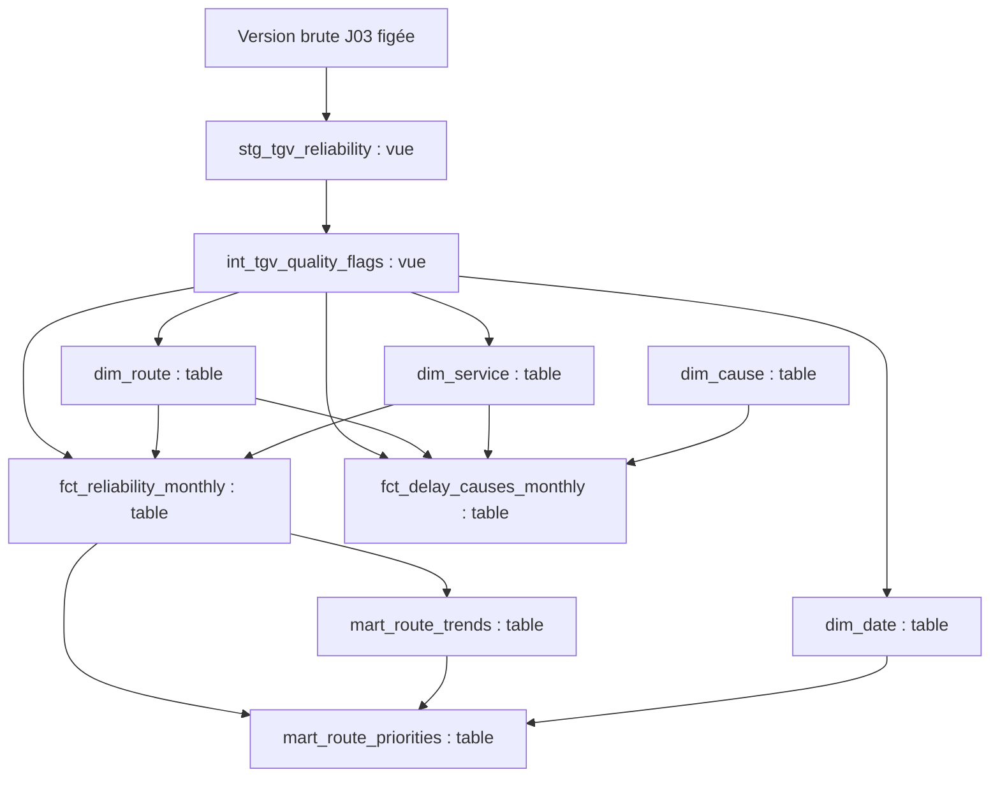

# Modèle analytique — J05

Le modèle fournit les mêmes effectifs et règles de calcul à l'analyse SQL J06 et
au futur modèle Power BI J07. La préparation a été présentée le 9 octobre 2026 ;
l'accord explicite reçu est « Ok tu peux implémenter ». Le contrat J01 et les
restrictions D01–D07 restent applicables. Les résultats de qualification sont
consignés séparément dans [le rapport](../reports/data_model_validation.md).

## Architecture, stockage et dépendances

Le PC conserve le code SQL/YAML et pilote dbt. BigQuery, en EU, exécute les requêtes.
Dans `sncf_dev`, les deux préparations J04 restent des vues classiques ; les huit
modèles J05 sont des tables reconstruites intégralement. Une table finale change
après reconstruction, pas automatiquement à chaque modification d'une source.
`sncf_publish` reste réservé à la livraison future ; aucune actualisation Power BI
n'est effectuée. La cohérence de publication et la reprise multi-table relèvent
de J09 : une exécution partielle J05 ne constitue pas une livraison validée.

Le diagramme ci-dessus montre les dépendances de construction. Les relations
analytiques des deux faits vers Date, Liaison et Service sont de plusieurs-à-un ;
le fait des causes possède en plus la relation vers Cause. Il n'existe aucune
jointure directe des deux faits dans les modèles livrés.

Les fichiers complets d'extraction restent sous `SNCF_DATA_DIR`, hors dépôt et
OneDrive, avec métadonnées et manifeste. Les exécutions J05, réussies ou échouées,
sont conservées dans `model_runs/<run_id>` au même emplacement externe. Le dépôt
ne reçoit que des résultats de contrôle ciblés. Les originaux de ces preuves sont
ignorés par Git ; leurs copies anonymisées sont publiées avec un manifeste.

## Grains et clés

| Table | Une ligne représente | Clé |
|---|---|---|
| `dim_date` | Un jour de calendrier, sur des années complètes couvrant source et comparaisons | `date_key` DATE |
| `dim_route` | Un couple départ → arrivée aux libellés exacts | `route_key`, SHA-256 du STRUCT ordonné sérialisé en JSON |
| `dim_service` | Un libellé de service source | `service_key`, SHA-256 du libellé exact |
| `dim_cause` | Une des six catégories du contrat | `cause_key`, code anglais explicite |
| `fct_reliability_monthly` | Un mois, une liaison orientée et un service | `(month, route_key, service_key)` |
| `fct_delay_causes_monthly` | Le même contexte, pour une catégorie de cause | `(month, route_key, service_key, cause_key)` |
| `mart_route_trends` | Une observation mensuelle et sa comparaison N−1 éventuelle | Même clé que le fait principal |
| `mart_route_priorities` | Une liaison/service National et une comparaison prédéfinie | `(route_key, service_key, comparison_id)` |

Une seule `version_id` source est autorisée dans les quatre faits/marts. Cette
colonne assure la provenance ; ajouter plusieurs versions comme des observations
métier doublerait les comptages. `row_number` et `row_sha256` relient les faits au
brut ; la position source n'est pas une clé métier stable. Les tables de dimensions
sont rattachées à la qualification par le manifeste et les résultats d'exécution.

La représentation JSON du couple évite une concaténation ambiguë : `A|B → C` et
`A → B|C` restent différents. A → B et B → A aussi. L'unicité est testée : aucune
empreinte ne doit masquer plusieurs couples. Un renommage de gare change la clé ;
aucune continuité géographique n'est certifiée sans référentiel officiel.

`month=2025-01-01` désigne janvier 2025. Le calendrier contient les autres jours,
mais ne crée aucun fait quotidien. Les analyses ferroviaires doivent employer
des sélections de mois complets ; un filtre journalier partiel n'a pas de sens pour
ces mesures mensuelles. Un mois absent reste absent des faits. La grille des
comparaisons compte séparément les mois attendus et les observations reçues.

## Mesures, unités et populations

Notations : P = `scheduled_trains`, A = `cancelled_trains`, L =
`arrival_delayed_trains`, N = `operated_trains_proxy`. **N=P−A est une convention
analytique non certifiée** (D01), même lorsque les contrôles arithmétiques réussissent.
`denominator_status` rappelle cette réserve dans le fait principal et les marts.

| Mesure | Calcul et disponibilité |
|---|---|
| `cancellation_rate` | A/P si `is_cancellation_rate_usable` |
| `arrival_delay_rate` | L/N si `is_arrival_delay_rate_usable` |
| `composite_regularity_rate` | (N−L)/N sous le même masque |
| `over_30_delay_rate`, `over_60_delay_rate` | Effectif du seuil/N si le couple important est utilisable |
| `over_30_delay_count`, `over_60_delay_count` | Effectif analytique sous masque de validité des effectifs importants |
| `published_cause_pct` | Valeur source 0–100, sans calcul de population |

Les taux calculés sont sur 0–1 et utilisent NUMERIC ; les parts source restent
FLOAT64 sur 0–100, sans renormalisation. Un NUMERIC arrondit les divisions à sa
précision disponible : les comparaisons de validation utilisent une tolérance
absolue de 1e-9 pour les taux/points lorsque le calcul indépendant diffère en
précision. Les effectifs et clés doivent correspondre exactement.

Les signaux aux seuils emploient des produits croisés d'effectifs NUMERIC avant
arrondi. Pour le seuil +2 points, vérifier
`100 × (Lc × Nr − Lr × Nc) >= 2 × Nc × Nr` sur dénominateurs positifs. Cette
formulation évite qu'un taux périodique déjà arrondi change le classement au seuil.
Pour la sous-performance : `100 × (N−L) < 90 × N` ; exactement 90 % n'est pas
sous la cible. Les hypothèses 2 points et 90 % appartiennent au portfolio, pas à
un engagement SNCF ni à un test de significativité statistique.

Les valeurs source restent intactes et distinctes des valeurs analytiques masquées.
Janvier–mars 2025 est indisponible pour le couple >30/>60, même si une valeur brute
particulière est positive. Les champs >15 ne deviennent pas des KPI génériques.
Les moyennes publiées restent descriptives avec leurs restrictions J04 ; elles
ne servent pas à la priorisation. Une anomalie d'un indicateur ne supprime pas
les autres usages valides de la ligne.

## Agrégation et comparaison

Pour une seule liaison/service, sommer les numérateurs et dénominateurs sur les
mêmes mois valides, puis diviser. Exemple fictif : 10/100 et 5/10 donnent 15/110,
soit environ 13,64 %, et non 30 %. Le mois à N=10 reste sous le seuil du classement.
Les colonnes `*_numerator`/`*_denominator` du mart montrent les populations employées.
Les sommes disponibles sur une partie des mois restent identifiables par la
couverture ; le taux d'une période est NULL si ses mois ne sont pas tous utilisables
pour cet indicateur. Une absence de population donne NULL, pas zéro.

Aucune somme interliaisons ne mesure des trains distincts. Un train peut appartenir
à plusieurs liaisons. Les seuils >30 et >60 sont imbriqués et ne s'additionnent pas.
Les deux faits ne se joignent pas pour sommer des effectifs : 100 trains répétés
sur six causes produiraient un faux total de 600.

`mart_route_trends` joint le mois à son mois exact N−1, même liaison/service/version.
Il ne remplace pas cette condition par la douzième ligne précédente. Les différences
mensuelles descriptives existent si les deux taux sont utilisables ; les signaux
de persistance exigent aussi le volume minimum. Le service sur l'ensemble de la
fenêtre reste contrôlé dans le mart des priorités.

| Comparaison | Fenêtre courante / référence | Critère |
|---|---|---|
| `2026_h1_vs_2025_h1` | Janvier–juin 2026 / janvier–juin 2025 | 6/6 mois valides de chaque côté et N≥30 chaque mois |
| `2025_vs_2024` | Année 2025 / année 2024 | 12/12 mois valides de chaque côté et N≥30 chaque mois |

Les candidats sont les liaisons/service National présentes dans l'historique de
la version, y compris celles absentes d'une fenêtre. L'éligibilité centrale exige
les effectifs centraux compatibles et un seul service dans l'union des deux
fenêtres, en examinant tous les services avant de sélectionner National. Elle est
distincte de la disponibilité des causes ou des retards importants. Les motifs
d'exclusion peuvent se recouvrir ; on ne les additionne pas.

Les taux descriptifs par période peuvent être disponibles pour une liaison de
faible volume ; `arrival_delay_change_pp` et `change_signal` n'autorisent la
comparaison principale que si `is_comparison_eligible` est vrai. Le signal est
`deterioration`, `improvement`, `below_project_threshold` ou `ineligible`.
« Sous le seuil » n'affirme pas une stabilité statistique.

La persistance est définie uniquement au semestre : nombre de paires à +2 points
ou plus / 6, et nombre de mois sous 90 % / 6. Au moins 4/6 active le booléen
correspondant. Les numérateurs de diagnostic peuvent exister ailleurs, mais les
ratios et booléens de persistance annuelle restent NULL. Aucune règle 4/12 ou 8/12
n'est inventée. J06 interprétera ces variables et testera la sensibilité, sans
modifier opportunément les règles de référence.

## Profils de causes

Le fait long garde six lignes par observation, même si une ou plusieurs parts
sont NULL (`UNPIVOT INCLUDE NULLS`). Un zéro est conservé comme zéro ; un profil
entièrement nul reste non exploitable. Une somme hors tolérance reste visible
avec son avertissement J04. `cause_sum_pct` est un diagnostic répété de profil,
jamais une mesure additive. Les six parts ne sont ni moyennées dans le temps,
ni converties en effectifs, ni assimilées à des parts de minutes de retard.

## Choix, alternatives et limites

BigQuery est conservé parce que l'entrepôt, le transport et les connexions existent.
Python rassemble les preuves et contrôle le transport ; SQL/dbt définit les règles
métier. Une deuxième transformation Python rendrait leur cohérence plus difficile.
Les tables finales matérialisées offrent des résultats prêts à consulter ; leur
reconstruction complète est lisible et prend en compte les corrections/suppressions
de la version brute. L'incrémental ajouterait une complexité sans besoin mesuré.
Les vues restent adaptées à la préparation J04. Aucun paquet dbt supplémentaire
n'est requis ; tests natifs, SQL métier et fixtures suffisent à ce périmètre.

Une dimension mensuelle serait plus compacte ; le calendrier quotidien est retenu
pour sa réutilisation future, avec convention mensuelle stricte. Une table unique
large serait plus simple à lire au début, mais moins sûre pour les causes et les
dimensions partagées. Un référentiel officiel de gares serait une extension utile,
conditionnée à des identifiants fiables. L'optimisation par partitionnement ou
clustering attend une mesure de coût ou de performance. La sensibilité, les
recommandations métier, DAX et la publication cohérente multi-table restent dans
leurs jalons prévus.

Les tests prouvent fidélité, arithmétique et encadrement des usages ; ils ne
certifient ni D01, ni le préavis des annulations, ni la population des causes, ni
une causalité. Aucun résultat n'est converti en voyageurs, incidents, coûts ou gains.

Références techniques consultées le 9 octobre 2026 :
[matérialisations dbt](https://docs.getdbt.com/docs/build/materializations),
[tests dbt](https://docs.getdbt.com/docs/build/data-tests),
[UNPIVOT BigQuery](https://docs.cloud.google.com/bigquery/docs/reference/standard-sql/query-syntax#unpivot_operator),
[SAFE_DIVIDE](https://docs.cloud.google.com/bigquery/docs/reference/standard-sql/mathematical_functions#safe_divide).
